<p align="center"></p>

<p align="center">
  <a href="https://github.com/manikantbindass/FlowNovaAI/actions"></a>
  
  
  
</p>

# FlowNova AI

A visual workflow workbench with two runtimes: a Vercel-native hosted demo, and Spring Boot with a relational database. Create a graph, save a draft, publish an immutable version, run it, and inspect persisted node results.

**Live app:** [flownova-ai.vercel.app](https://flownova-ai.vercel.app) · [Sign in](https://flownova-ai.vercel.app/login) · [Runtime choices](https://flownova-ai.vercel.app/setup). The hosted demo includes sessions, private persistence, and real execution on Vercel Workflows.

## Windows desktop download

[Download FlowNova AI for Windows (.exe)](https://github.com/manikantbindass/FlowNovaAI/releases/latest) · [Build and desktop documentation](docs/DESKTOP.md)

The portable x64 desktop client opens the live Vercel workspace without installing Java or Node.js. Internet access is required. Sign in with **demo / demo**; desktop and browser sessions have separate demo data. The executable is unsigned; its release includes a SHA-256 checksum.
## Demo login

Use the hosted demo or local backend, then sign in with:

| Username | Password |
| --- | --- |
| `demo` | `demo` |

These are public development credentials, not production secrets. The account opens the local Nova workspace. `viewer` / `demo` is read-only; `other` / `demo` opens an isolated test workspace. Set `LOCAL_PASSWORD` to override the shared development password. The production profile disables these accounts and requires an OIDC issuer and provisioned memberships.

On Vercel these public credentials open a private browser-scoped demo workspace. Records persist in private Blob storage; Vercel Workflows executes real nodes. Keep the session cookie to return to your data. Clearing cookies loses access to that demo workspace. No Java or separate database setup is required by visitors. Hosted limits are 25 workflows, 20 versions per workflow, 50 runs, 2 active runs, and 2 MB workspace data; Vercel Hobby caps also apply. This is an evaluation environment, not verified organizational identity.

## What works

- Visual node editing, connections, configuration, zoom/pan/minimap, layout, copy/paste, undo/redo, JSON import/export, and explicit draft saves.
- Manual trigger, JSON mapping, conditions, bounded delays, collection processing, data assertions, and an optional configured OpenAI completion node.
- Backend validation, revision conflict detection, immutable published snapshots, and version history.
- Java runtime: persisted execution queue, lease claims, node checkpoints, bounded stale-lease recovery, cancellation, idempotency keys, and a 120-second deadline.
- Workspace membership and viewer/editor authorization, CSRF-protected local sessions, field-name redaction, audit records, request limits, and database-backed metrics.
- Dark, light, and system themes; responsive navigation; searchable command palette; functional templates.

HTTP/app connectors, verified browser OIDC onboarding, invitations, arbitrary code, retrieval, subscriptions, Redis coordination, and advanced agents remain planned. This is a functional hosted demo and relational foundation, not a production-ready enterprise release.

## See it working

The animation below uses real captures from a hosted workflow: build, publish, enter input, execute, inspect history, and view recorded metrics.

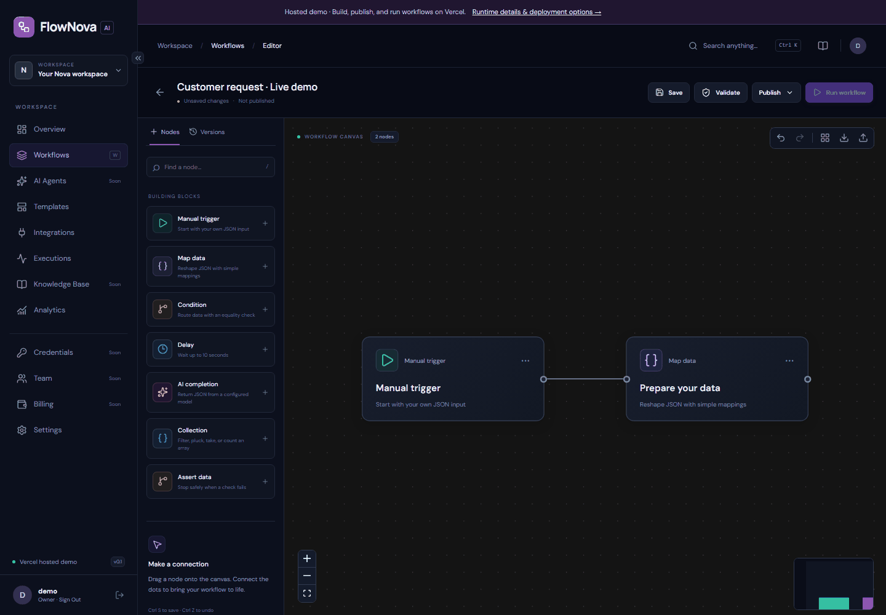

<details>
<summary>All application screenshots</summary>

**Landing page**
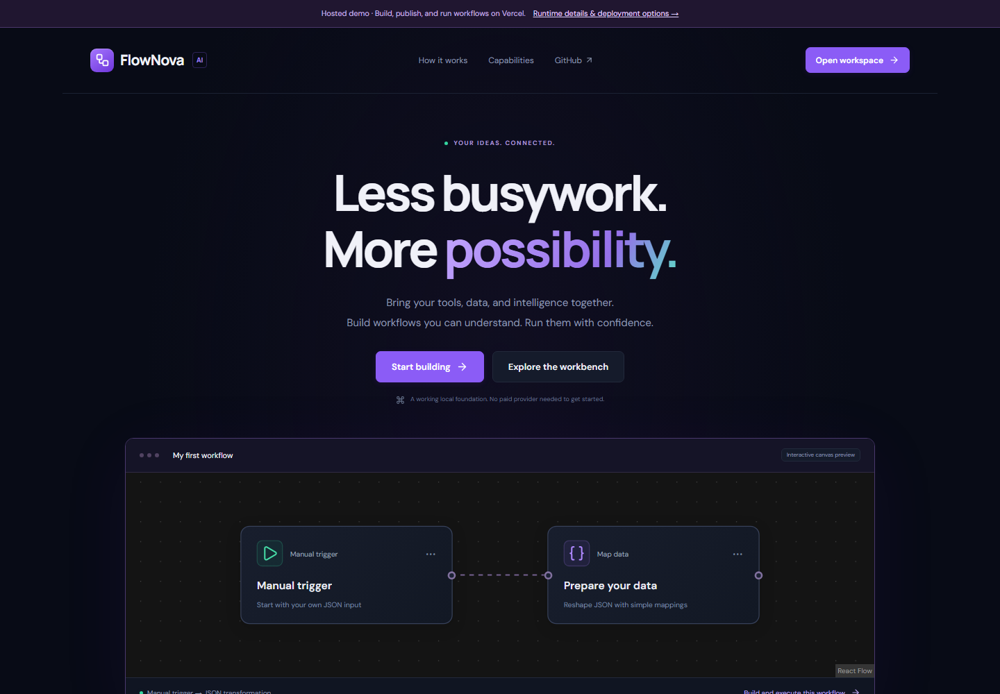

**Workspace overview with actual recorded metrics**
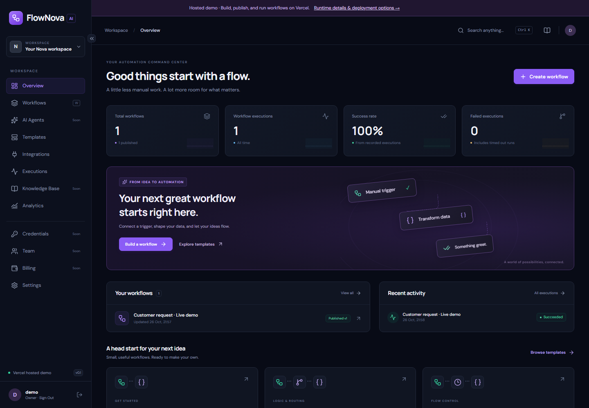

**Visual editor**
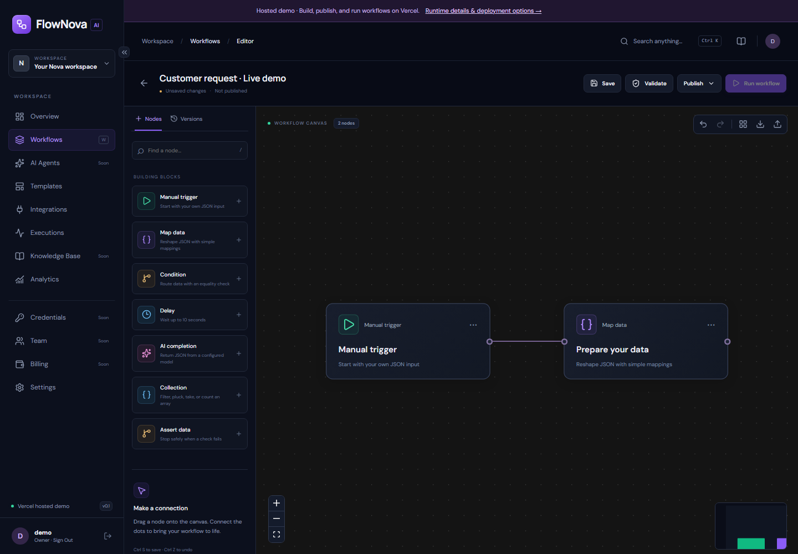

**Published workflow**
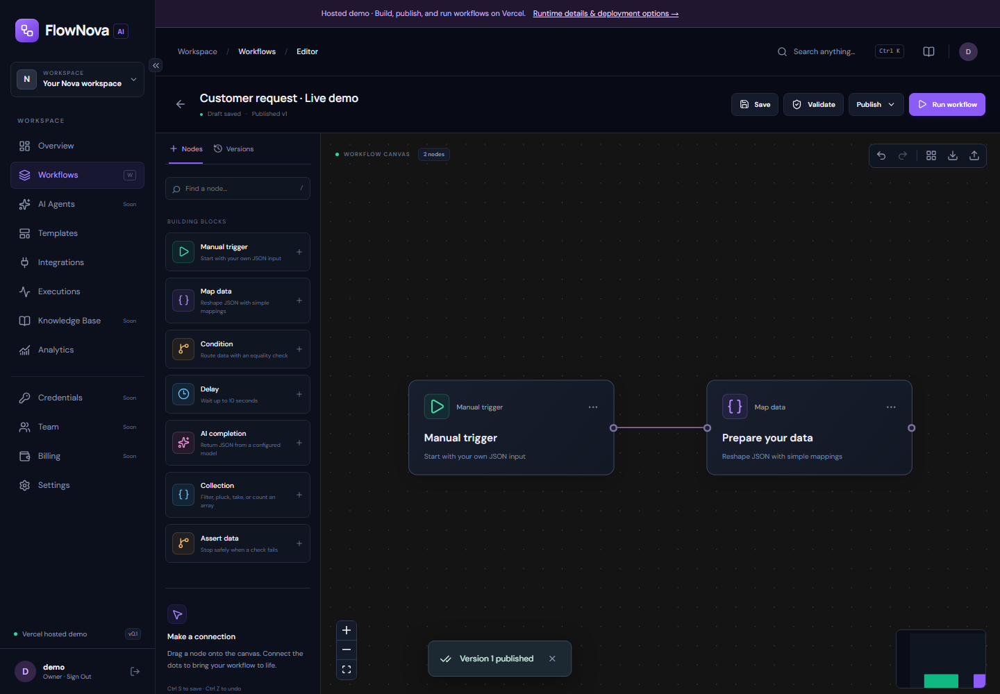

**Run input**
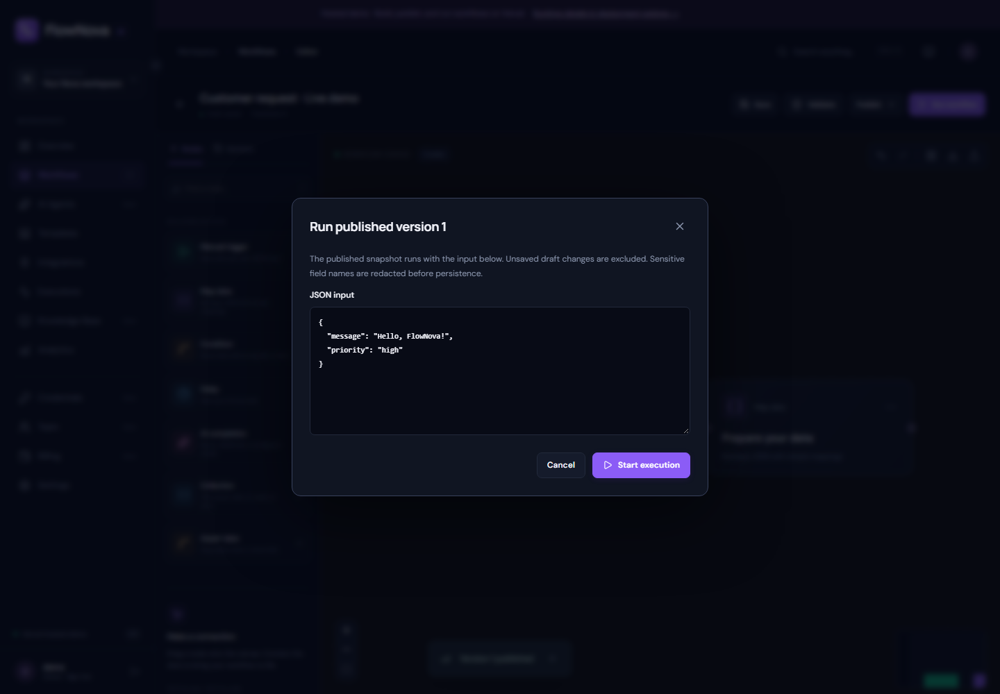

**Completed execution and node outputs**
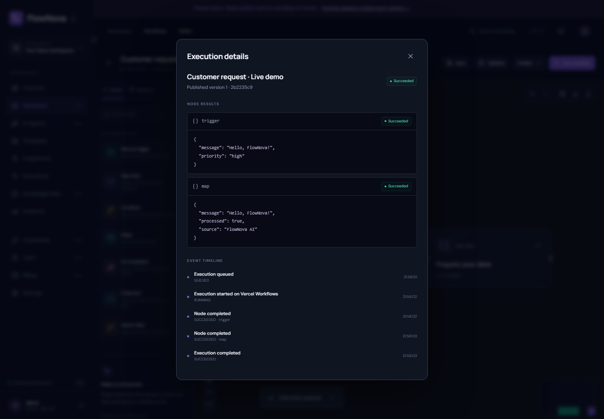

**Execution history**
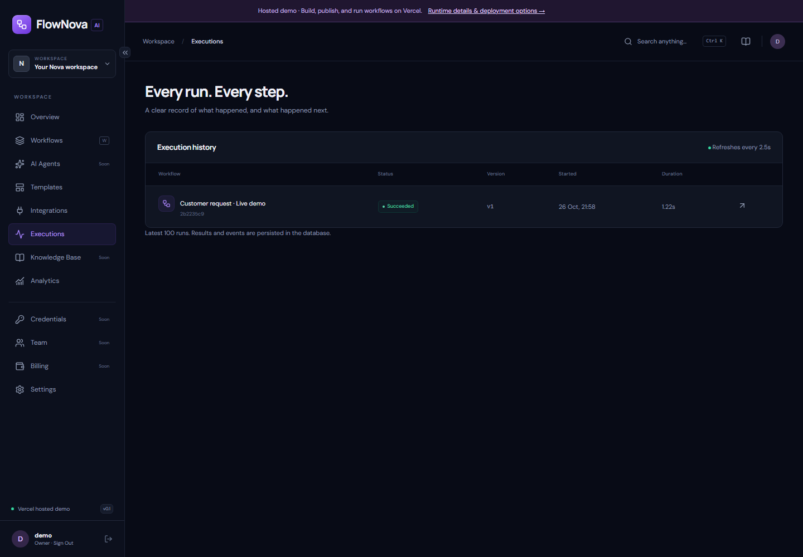

**Real workspace analytics**
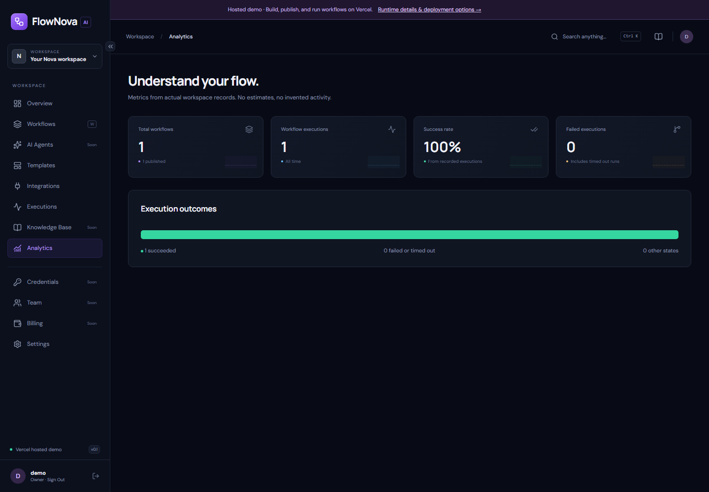

**Phone layout**
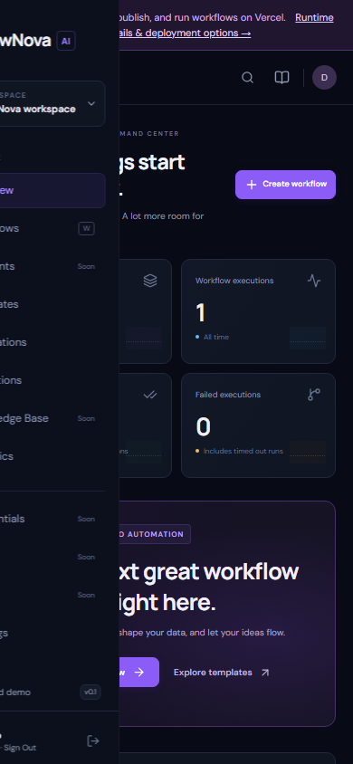

</details>

## Project guides

- [Detailed project PDF](docs/guides/FlowNova-AI-Project-Guide.pdf)
- [Editable PowerPoint overview](docs/guides/FlowNova-AI-Project-Overview.pptx)
- [Complete architecture explanation](architecture.md)
- [Advanced platform roadmap toward 2027](docs/ROADMAP_2027.md)

## Run locally

Prerequisites: Node 22 or later and a JDK 21 or later. Maven is downloaded by the included wrapper. The verified machine uses Node 24 and JDK 25. Docker is optional for the file-backed local profile.

```powershell
npm ci
```

API terminal, from the repository root:

```powershell
# Set JAVA_HOME to your installed JDK if necessary.
$env:JAVA_HOME = 'C:\Program Files\Java\jdk-25'
$env:SERVER_PORT = '8181'
cd apps/api
.\mvnw.cmd spring-boot:run
```

Web terminal, from the repository root:

```powershell
$env:API_ORIGIN = 'http://127.0.0.1:8181'
npm run dev --workspace apps/web -- --port 3210
```

Open [http://127.0.0.1:3210](http://127.0.0.1:3210), choose **Open workspace**, and use **demo / demo**. The health endpoint is [http://127.0.0.1:8181/actuator/health](http://127.0.0.1:8181/actuator/health). Local records persist under `apps/api/.data/`, which is ignored by Git. Ports are configurable; these alternatives avoid existing services on this development machine.

On Linux/macOS use `export JAVA_HOME=...`, `export SERVER_PORT=8181`, `./mvnw spring-boot:run`, and `API_ORIGIN=http://127.0.0.1:8181 npm run dev --workspace apps/web -- --port 3210`.

### PostgreSQL with Docker

```sh
docker compose up --build
```

Compose uses loopback ports 3000 (web), 8080 (API), and 5432 (PostgreSQL), with a persistent database volume. Change port mappings if occupied. `.env.example` documents development values; copy it to ignored `.env` only when using Compose. Host Maven does not automatically read `.env`. Docker startup has not been verified on the original machine because its daemon is stopped.

### Try your first workflow

1. Sign in and select **Create workflow**, or clone a template.
2. Click a node, edit its JSON configuration, and choose **Apply configuration**.
3. Choose **Save**, then **Validate**. Draft saves are explicit; Ctrl S also saves.
4. Choose **Publish** and confirm the new immutable version.
5. Choose **Run workflow**, supply JSON input, and inspect results and the event timeline.
6. Edit the draft and run again: the published snapshot remains unchanged until another publish.

Mapping example: `{"mapping":{"message":"$.message","processed":true}}`. A condition emits `{matched, data}`, so a downstream mapping reads the original message with `$.data.message`.

### Optional AI

Set `OPENAI_API_KEY` on the Java server and optionally `OPENAI_MODEL`, then restart it. Keys stay on the server. AI calls use JSON output mode, a 25-second request timeout, and at most 512 output tokens. Provider charges may apply. Without a key, the AI node fails with a clear configuration error; deterministic workflows still run. No live provider call has been verified.

## Checks

```sh
npm run lint
npm run typecheck
npm test
npm run build
cd apps/api
./mvnw verify
```

With both servers running, install Chromium using `npx playwright install chromium`, then run `npm run test:e2e` from the root. Set `WEB_URL` if the web port differs from 3210. For PostgreSQL integration testing, set `TEST_DATABASE_URL`, `DATABASE_USER`, and `DATABASE_PASSWORD` before running the backend integration suite.

## Deployment and documentation

The Vercel runtime uses Next.js Functions, iron-session protected cookies, private Blob documents with conditional writes, and Vercel Workflows. Connect a private Blob store and leave `API_ORIGIN` unset. Visitors need no backend setup. Set `API_ORIGIN` only when intentionally selecting a separately hosted Java/PostgreSQL API. See [deployment instructions](docs/DEPLOYMENT.md) and the [runtime decision](docs/decisions/0002-vercel-hosted-runtime.md).

| Guide | Purpose |
| --- | --- |
| [Architecture](docs/ARCHITECTURE.md) | Boundaries and execution lifecycle |
| [Development](docs/DEVELOPMENT.md) | Setup and troubleshooting |
| [API](docs/API.md) | Routes, authentication, and contracts |
| [Database](docs/DATABASE.md) | Tables, locking, and migration policies |
| [Security](docs/SECURITY.md) | Implemented controls and remaining gaps |
| [Testing](docs/TESTING.md) | Commands and verification evidence |
| [Progress](docs/PROGRESS.md) | Current delivery status |
| [Next steps](docs/NEXT_STEPS.md) | Remaining milestones |

No license has been selected; no open-source license grant is implied.

<p align="center"></p>
