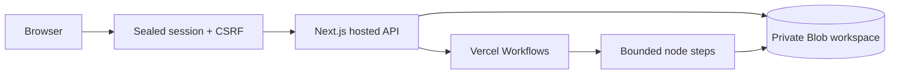
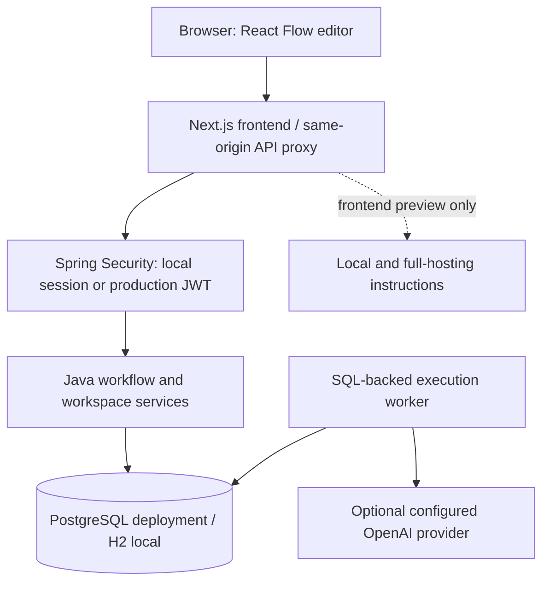
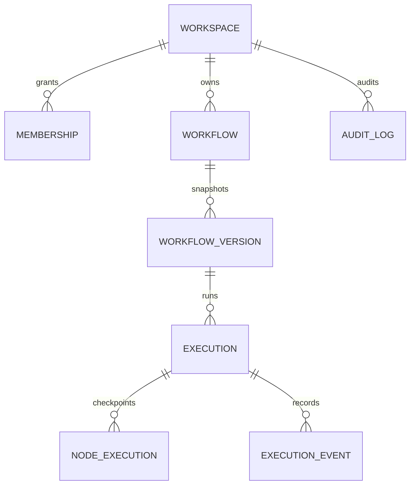
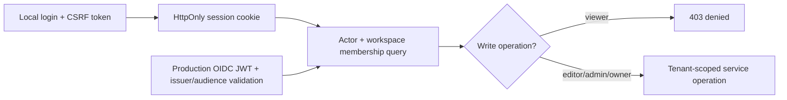
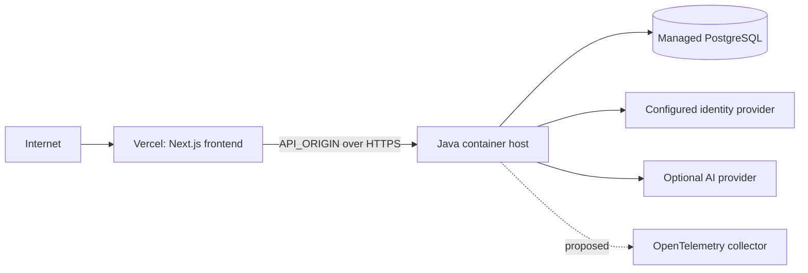

# FlowNova AI: project architecture

This document explains the implemented local platform and the path to a hosted service. It describes source behavior, not an assurance of production readiness. See [the detailed architecture](docs/ARCHITECTURE.md), [deployment](docs/DEPLOYMENT.md), and [2027 roadmap](docs/ROADMAP_2027.md).

## What the product does

FlowNova lets a user draw a workflow, configure its nodes, validate the graph, publish a version, and execute that exact version with a JSON input. The browser shows persisted execution status, node outputs, and events. It supports deterministic data processing without AI credentials and an optional bounded OpenAI completion. Public demo credentials are `demo` / `demo` in the development profile.

## System boundaries

### Vercel-native hosted runtime

The deployed core runs without Java. Next.js Functions provide the compatible API; iron-session seals authenticated workspace identity and CSRF data in an HttpOnly cookie. Public demo login creates a private browser-scoped workspace. Private Vercel Blob stores its bounded document. Reads pair authoritative metadata ETags with matching version-keyed content; conditional writes retry conflicts instead of overwriting concurrent changes. Vercel Workflows persists orchestration, node steps, and durable delays. Optional AI calls use owner-configured server credentials.



Hosted limits are 25 workflows, 20 versions each, 50 run records, two active runs, and a 2 MB workspace document. Cookies retain the demo workspace reference; clearing them loses access. This is evaluation identity, not verified organizational membership. Blob storage is not presented as an unlimited SQL replacement. See [the runtime decision](docs/decisions/0002-vercel-hosted-runtime.md).

### Java relational runtime



Next.js owns rendering, editor interaction, and the same-origin transport. The Java API owns membership checks, graph validation, draft revisions, publishing, execution requests, limits, audit records, and metrics. The worker shares the Java process initially. No Node connector service duplicates the engine. PostgreSQL is the production database target; local H2 persists in an ignored development directory.

## Workflow lifecycle

1. The editor creates a draft containing XYFlow node positions, type/version metadata, node configuration, and edges.
2. An explicit save sends the expected revision. A stale revision receives HTTP 409; the API never silently overwrites it.
3. Validation checks node types and schema versions, configuration, one manual trigger, edge endpoints, reachability, cycles, and supported branch handles. Joins and graph cycles are rejected in v1.
4. Publishing locks the workflow and copies the graph into a new immutable workflow-version row. Publishing requires a revision match and user confirmation in the UI.
5. Starting a run checks membership, editor rights, input limits, publication, hourly workspace usage, and an idempotency key. Execution insertion and its queued event share a transaction.
6. The worker claims a queued execution with a database compare-and-set and lease token. It reads the published snapshot, executes eligible nodes, persists checkpoints and events, and reaches a terminal state.
7. Later draft edits do not change any published snapshot or running execution. Restoring an old version copies its graph into a new draft revision rather than mutating history.

```mermaid
sequenceDiagram
 participant B as Browser
 participant A as Java API
 participant D as Database
 participant W as Worker
 B->>A: Save draft + expected revision
 A->>D: Tenant-scoped conditional UPDATE
 B->>A: Publish + confirmation
 A->>D: Lock workflow; INSERT immutable version
 B->>A: Execute + Idempotency-Key + input
 A->>D: Transaction: execution + queued event
 W->>D: Compare-and-set claim + lease
 loop Each eligible node
 W->>D: Check cancellation/deadline; checkpoint result + event
 end
 W->>D: Terminal status
 B->>A: Poll execution details
 A->>D: Read persisted results and timeline
```

## Nodes and data semantics

| Node | Current behavior | Boundaries |
| --- | --- | --- |
| Manual | Returns the supplied JSON object | Exactly one trigger |
| Transform | Builds a new object using literals and `$.path` references | At most 40 mapping keys; missing paths become null |
| Condition | Compares a path with a literal, returns `{matched,data}` | One edge per true/false output; unselected descendants are skipped |
| Delay | Waits while checking cancellation | At most 10 seconds |
| AI completion | Sends prompt and redacted input to configured OpenAI model | JSON object response; 25 seconds; 512 output tokens; no tools |
| Collection | Filters, plucks, takes, or counts input array items | At most 1,000 inspected items and 100 returned items |
| Assert | Requires a path to equal a configured value | Fails the run with a safe message on mismatch |

Each non-trigger node has at most one incoming edge. This deliberately avoids ambiguous merge semantics. Nodes are executed in a deterministic traversal; independent parallel execution is not implemented. User scripts and network-request nodes are not supported.

## Data model



Workspace IDs scope workflow, version, execution, membership, and audit queries. Composite workflow/workspace foreign keys prevent cross-workspace execution references. Published snapshots and node checkpoints have distinct tables. See the Flyway migration for constraints and indexes.

## Identity and security



Local accounts are explicitly public development accounts. Production disables them and accepts external OIDC JWTs; browser OIDC onboarding is still planned. No bearer token is stored in browser localStorage. CSRF is enabled for the session profile, and production JWT requests are stateless. Cookie flags, field-name redaction, input caps, process-local request rate limits, and safe error messages are implemented. Shared rate limiting, durable external sessions, RLS, comprehensive secret scanning, and security assessment remain work.

## Durability and scaling

The database is the execution queue. Atomic compare-and-set claims stop multiple workers from holding the same current lease. Checkpoints and lease checks fence stale workers before database writes. Expired leases are reconciled with at most three attempts; eligible pure nodes resume from persisted checkpoints. A crash during an external AI call may repeat the call and its cost. Arbitrary external side effects do not have exactly-once guarantees.

The initial worker executes one job at a time per Java process. Scaling means measuring queue depth and DB load, separating worker and API roles, adding bounded worker pools, limiting noisy tenants, and testing database claims under concurrency. PostgreSQL compatibility, multi-worker load, database recovery, and production failover require additional verification. No throughput promises are made.

## Deployment



The Vercel deployment contains the hosted demo API, private workspace persistence, and durable execution. It does not provision Java or PostgreSQL. The relational platform can run with the Maven wrapper and Next.js; Docker Compose provides PostgreSQL configuration. A production enterprise deployment still needs verified identity, retention, measured scaling, backup/restore drills, security assessment, and observability. The Java option additionally needs a long-running Java host and persistent PostgreSQL.

## 2027 direction

Proposed additions include permissioned MCP tools, A2A interoperability, bounded agent tasks, human approvals, schema-validated generation, retrieval with citations, semantic evaluation, signed webhooks, durable schedules, safe connector egress, and policy/usage budgets. These are roadmap proposals, not predictions that a standard or product capability will exist in a specific future form. See the roadmap for dependencies and references.
