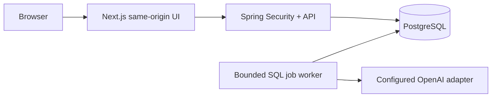
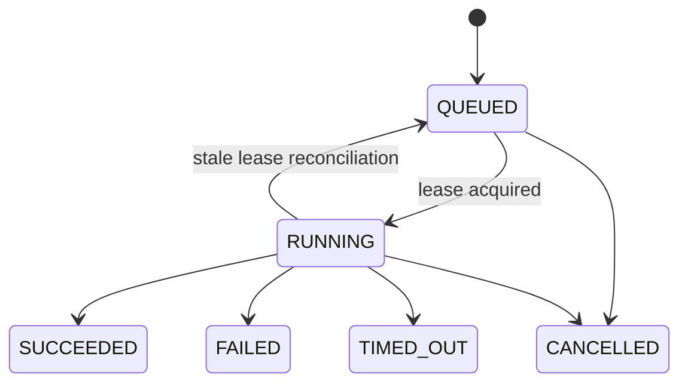

# Architecture

FlowNova offers a Vercel-native hosted demo and a Spring Boot relational runtime. The hosted API uses iron-session cookies, private Blob documents with conditional writes, and Vercel Workflows steps. The relational mode uses PostgreSQL or local H2 with Flyway/JDBC and a SQL queue. Set API_ORIGIN to select the external Java API; leave it unset on Vercel to use the hosted adapter. See root architecture.md and decisions/0002-vercel-hosted-runtime.md for the complete comparison. The following diagram and lease details describe the Java mode.

Drafts use optimistic revisions; publishing inserts an immutable snapshot. Executions reference the exact version. Database queue insertion and execution creation are one transaction. A compare-and-set lease claims work; completed node checkpoints allow pure transformations to resume. External AI is at-least-once and can incur duplicate provider costs after crash. Arbitrary external side effects and unsafe automatic replay are not supported.

Authentication: Spring Security sessions with CSRF protection and local-only development accounts. Production JWT resource-server mode requires an external OIDC provider and provisioned membership; browser OIDC login is a later milestone. Cookies are HttpOnly, SameSite=Lax and secure in deployment. Local development binds loopback. No sensitive browser tokens are stored in localStorage.
